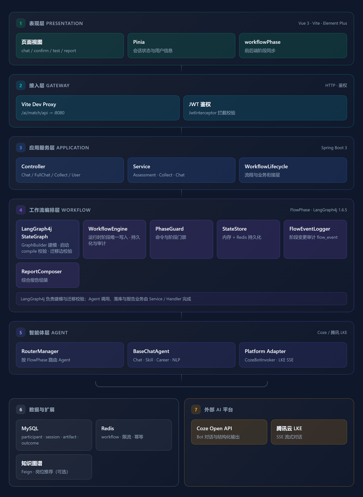
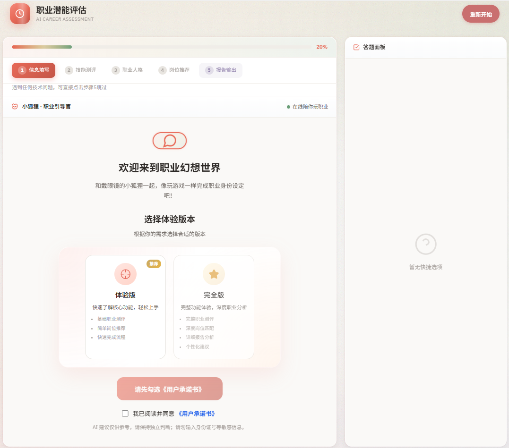
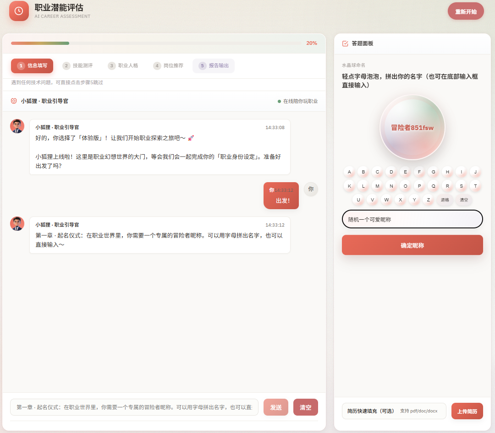
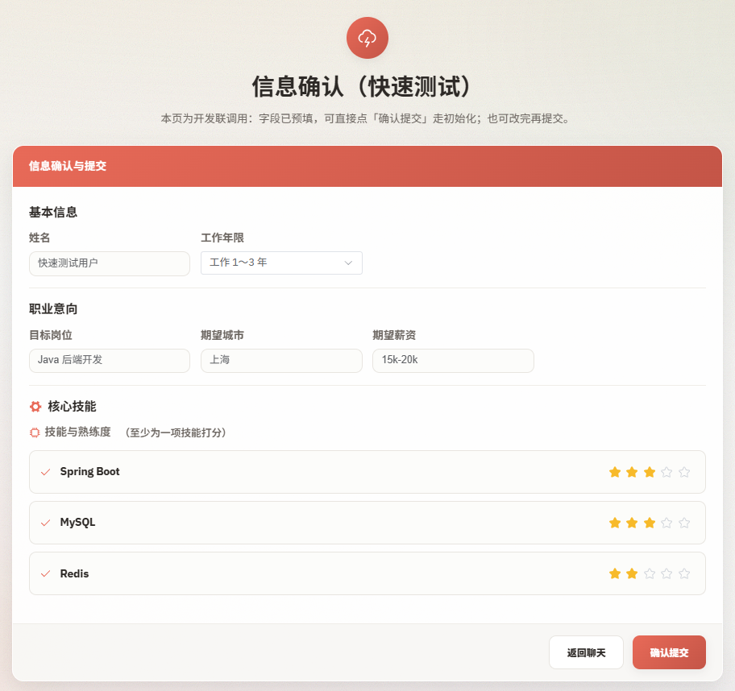
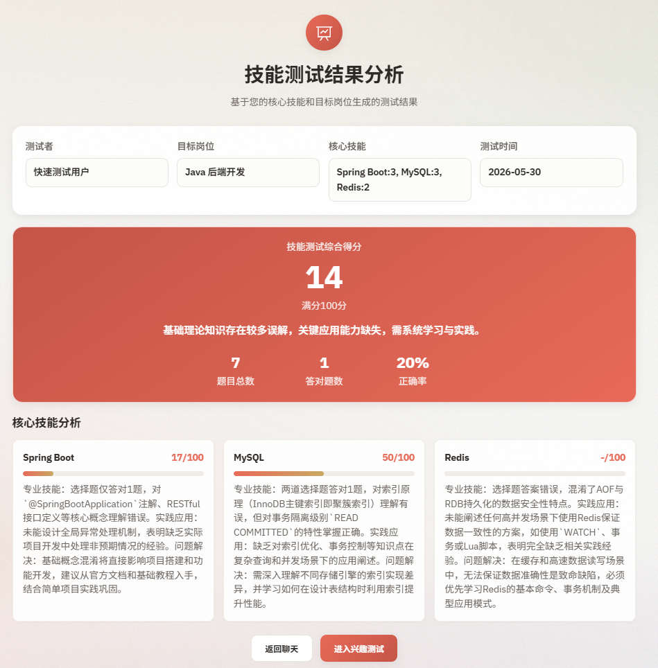
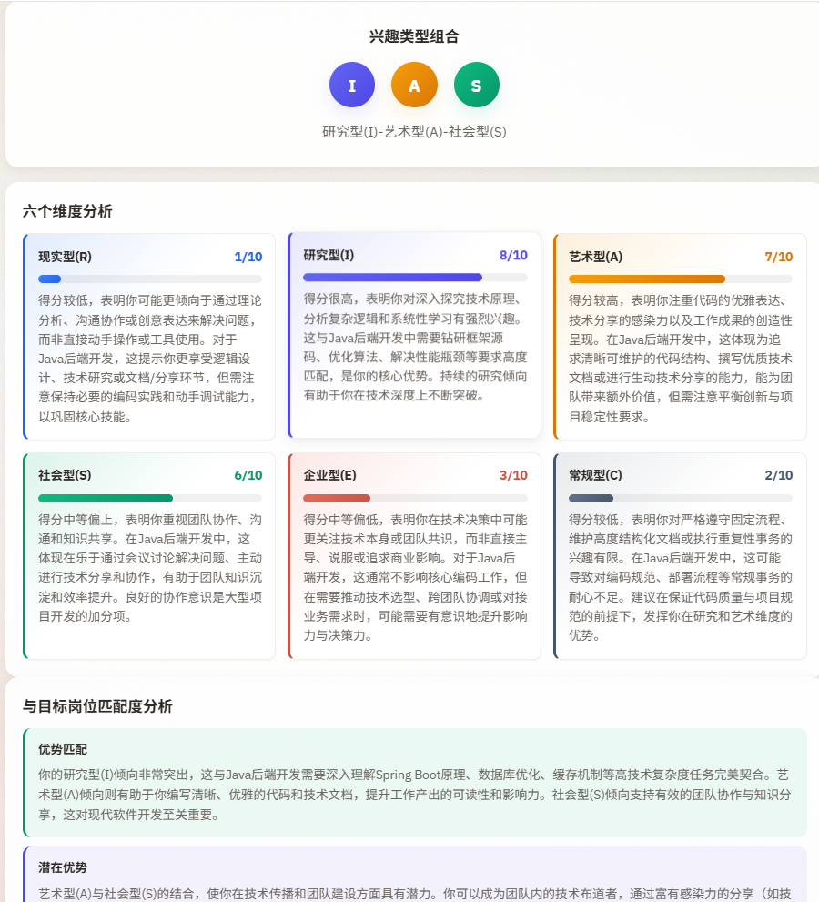
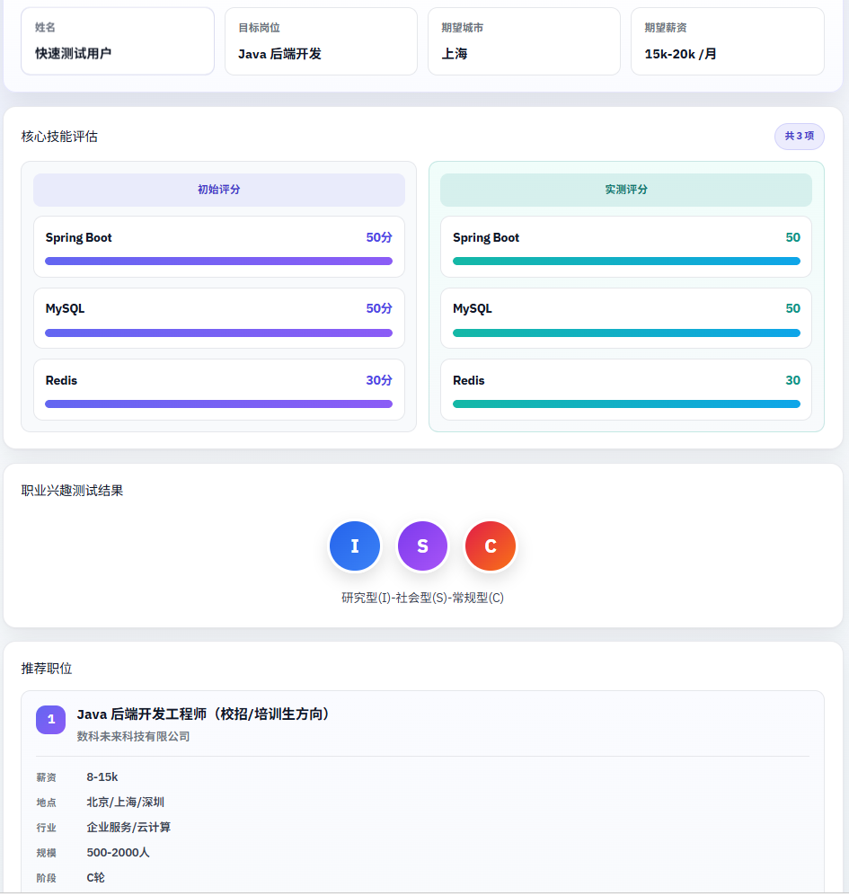

# Career Compass（职业罗盘）

> AI 驱动的职业潜能评估与职业规划辅助平台

[](LICENSE)
[]()
[]()
[]()

---

## 项目简介

Career Compass 面向职业探索与能力评估场景，通过对话式信息采集、结构化技能测评、霍兰德职业兴趣测评及综合评价报告，为用户提供职业方向参考。

系统采用前后端分离架构，后端以 **FlowPhase 状态机 + WorkflowEngine** 编排测评流程，并用 **LangGraph4j** 建模阶段迁移图、在启动时编译校验并在阶段切换时校验合法迁移；前端通过阶段同步与后端保持一致。AI 能力可对接 Coze 或腾讯云 LKE，并可选接入知识图谱服务进行岗位推荐。

---

## 功能特性

| 模块 | 说明 |
|------|------|
| 对话式信息采集 | 以对话替代传统表单，支持简历解析与信息快速填充 |
| 体验版 / 完全版 | 体验版支持完整主流程快速验证；完全版支持多轮技能测评（可按配置开放） |
| Workflow 状态机 | **WorkflowEngine** 驱动阶段流转；**LangGraph4j** 定义 StateGraph 并校验迁移；**PhaseGuard** 控制 API 门禁。主链路：信息采集 → 信息确认 → 主对话 → 技能测评 → 霍兰德测评 → 岗位共识 → 综合报告 |
| 技能与兴趣测评 | 对接 Coze / 腾讯 LKE Agent，输出结构化题目与测评报告 |
| 综合评价报告 | 整合技能分析、兴趣匹配、岗位推荐及可选简历优化建议 |
| 用户协议与合规 | 测评开始前须勾选《用户承诺书》，含 AI 使用与隐私相关说明 |
| 知识图谱（可选） | 人才画像同步与岗位推荐，可通过 `kg.service` 配置开关 |

---

## 技术栈

| 层级 | 技术 |
|------|------|
| 后端 | Java 17、Spring Boot 3、MyBatis-Plus、MySQL 8 |
| 工作流 | LangGraph4j 1.6.5、自研 WorkflowEngine（FlowPhase 状态机） |
| 前端 | Vue 3、Vite、Element Plus、Pinia |
| AI 接入 | Coze Open API、腾讯云 LKE（可配置切换） |
| 基础设施 | Redis（可选，用于 Workflow 持久化、限流与幂等） |
| 扩展 | 知识图谱服务（Feign，可选） |

---

## 系统架构

系统采用前后端分离的分层架构：表现层（Vue 3）→ 接入层（代理与 JWT）→ 应用服务层（Spring Boot）→ **Workflow 编排层**（WorkflowEngine + LangGraph4j + PhaseGuard）→ 智能体层（Coze / 腾讯 LKE）→ 数据与外部服务（MySQL、Redis、知识图谱）。

### Workflow 编排说明

| 组件 | 职责 |
|------|------|
| `AssessmentWorkflowGraphBuilder` | 使用 LangGraph4j `StateGraph` 建模体验版 / 完全版阶段与边（含技能、职业多轮 **条件自循环**），启动时 `compile()` 校验图结构 |
| `LangGraphWorkflowAdapter` | 在 `WorkflowEngine.transition` 时校验 `FlowPhase` 迁移是否合法 |
| `WorkflowEngine` | **运行时唯一阶段写入入口**，负责持久化、审计（`flow_event`）与上下文同步 |
| `PhaseGuard` | 校验当前阶段是否允许执行某 API 命令 |

> LangGraph4j 负责**建模与迁移校验**；Agent 调用、落库与报告组装仍由 Spring Service / Handler 完成。

<p align="center">
  
</p>

<p align="center"><em>图 7 · 系统分层架构</em></p>

---

## 演示截图

<details>
<summary>界面预览（展开查看）</summary>

<p align="center">
  
</p>
<p align="center"><em>图 1 · 开始页</em></p>

<p align="center">
  
</p>
<p align="center"><em>图 2 · 对话式信息收集</em></p>

<p align="center">
  
</p>
<p align="center"><em>图 3 · 信息确认</em></p>

<p align="center">
  
</p>
<p align="center"><em>图 4 · 技能测评</em></p>

<p align="center">
  
</p>
<p align="center"><em>图 5 · 霍兰德职业兴趣测评</em></p>

<p align="center">
  
</p>
<p align="center"><em>图 6 · 综合评价报告</em></p>

</details>

---

## 目录结构

```text
career-compass/
├── src/main/java/              # Spring Boot 后端源码
│   └── .../workflow/graph/     # LangGraph4j 状态图与迁移校验
├── src/main/resources/
│   ├── application.yml         # 默认配置（不含密钥）
│   └── sql/                    # 数据库脚本
│       └── career-compass.sql
├── ui/                         # Vue 3 前端
├── assets/screenshots/         # README 演示截图
├── _local/                     # 本地私有文件（不提交，见 _local/README.md）
└── README.md
```

---

## 环境要求

| 组件 | 版本要求 |
|------|----------|
| JDK | 17 及以上 |
| Maven | 3.8 及以上 |
| MySQL | 8.0 及以上 |
| Node.js | ^20.19 或 >= 22.12 |
| Redis | 可选 |

---

## 快速开始

### 1. 克隆仓库

```bash
git clone <仓库地址>
cd career-compass
```

### 2. 初始化数据库

```bash
mysql -u root -p -e "CREATE DATABASE IF NOT EXISTS career_compass DEFAULT CHARSET utf8mb4;"
mysql -u root -p career_compass < src/main/resources/sql/career-compass.sql
```

已有旧版库结构时，请使用 `src/main/resources/sql/` 下的迁移脚本，勿直接执行全量建表脚本覆盖生产数据。

### 3. 配置后端

在 `src/main/resources/` 下创建 **`application-local.yml`**（已列入 `.gitignore`），或通过环境变量注入：

```bash
# Windows 示例
set SPRING_PROFILES_ACTIVE=local
set MYSQL_URL=jdbc:mysql://localhost:3306/career_compass
set MYSQL_USERNAME=root
set MYSQL_PASSWORD=your_password
```

需配置的敏感项包括但不限于：`coze.api-token`、各 Agent `bot-id`、`tencent.lke.*`、`jwt.secret`、`encrypt.aes-key`、`MYSQL_*`、`REDIS_*`。

### 4. 启动后端

```bash
mvn spring-boot:run
```

- 服务地址：`http://localhost:8080`
- API 文档（开发环境）：`http://localhost:8080/swagger-ui.html`

### 5. 启动前端

```bash
cd ui
npm install
npm run dev
```

- 开发地址：`http://localhost:5173`
- 开发环境下，`/ai/match/api` 由 Vite 代理至后端 `8080` 端口

---

## API 概览

| 路径前缀 | 说明 |
|----------|------|
| `/chat/*` | 体验版：初始化、对话、技能/霍兰德作答、反馈 |
| `/full/chat/*` | 完全版（需配置开放） |
| `/collect/*` | 分步信息收集 |
| `/user` | 用户创建与 Token 签发 |

详细接口定义见 Swagger 文档或源码中的 Controller 层。

---

## 配置说明

| 配置方式 | 用途 | 是否入库 |
|----------|------|:--------:|
| `application.yml` | 默认、非敏感配置 | 是 |
| `application-local.yml` | 本地开发密钥与连接信息 | 否 |
| 环境变量 | CI/CD 或生产部署 | 否 |

前端环境变量示例（`ui/.env.development`）：

```env
VITE_ENABLE_ENCRYPT=false
```

---

## 数据库设计

采用以 **Session（测评会话）** 为中心的数据模型，核心表如下：

| 表名 | 职责 |
|------|------|
| `assessment_participant` | 参与者档案 |
| `assessment_session` | 测评会话及当前阶段 |
| `assessment_artifact` | 技能/职业/报告/反馈等产物 |
| `assessment_outcome` | 会话级结果快照 |
| `chat_message` | 对话消息记录 |
| `flow_event` | Workflow 阶段变更审计 |

完整 DDL 见 [`src/main/resources/sql/career-compass.sql`](src/main/resources/sql/career-compass.sql)。

---

## 许可证

本项目采用 [Apache License 2.0](LICENSE) 开源协议。

Copyright 2026 The Career Compass Authors
